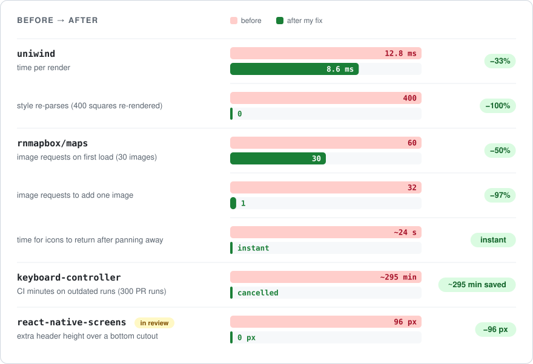

<h1 align="center">Jaydeep Agravat</h1>

  <b>React Native dev.</b> I fix the open-source libraries React Native apps are built on, 
  and every fix comes with a reproduction and the numbers to prove it.

  <code>3 merged</code> · <code>1 fixed after my repro</code> · <code>4 in review</code>

  <a href="https://jaydeep-agravat-portfolio.vercel.app/"><b>Portfolio</b></a> ·
  <a href="#merged">Merged work</a> ·
  <a href="#in-review">In review</a> ·
  <a href="#how-i-work">How I work</a>

---

### The ledger

Before and after, measured on the same device and setup, in libraries other teams maintain.

<picture>
  <source media="(prefers-color-scheme: dark)" srcset="assets/ledger-dark.svg">
  
</picture>

The rnmapbox numbers are the maintainer's own, measured during review.

---

<h3 id="merged">Merged</h3>

####  rnmapbox/maps · [#4450](https://github.com/rnmapbox/maps/pull/4450) · merged one day after I opened it

On iOS, `<Images>` downloaded every image again whenever the list changed, and map icons went blank after panning away and back. Now only new or changed images are downloaded, and each one gets a placeholder first, as on Android. Fixes [#4436](https://github.com/rnmapbox/maps/issues/4436).

| Measured by the maintainer | Before | After |
| --- | ---: | ---: |
| First load, 30 images | 60 requests | **30** |
| Add one image | 32 requests | **1** |
| Pan far away and back | 31 missing images, ~24 s to refill | **0, instant** |

> *"Thanks, this looks good."* · [mfazekas](https://github.com/mfazekas), maintainer, approving with the numbers above

####  uniwind · [#764](https://github.com/uni-stack/uniwind/pull/764) · **12.8 → 8.6 ms per render**

One `data-[…]` variant made uniwind re-parse a component's styles on every render. I cached the result by the data props each rule actually reads. Review caught a slower first resolve, so I fixed that with benchmarks against `main`, then rewrote it to the simpler design the maintainer preferred. Measured on the issue's repro app (400 squares re-rendered 30 times): **400 → 0 re-parses**.

####  react-native-keyboard-controller · [#1748](https://github.com/kirillzyusko/react-native-keyboard-controller/pull/1748) · **~295 runner-minutes**

In the last 300 PR runs, about 40 kept going after a newer push: about 295 runner-minutes, 145 of them on macOS. Each workflow now has its own concurrency group per pull request, so a new push cancels only the outdated run.

> *"Thank you for your contribution!"* · [kirillzyusko](https://github.com/kirillzyusko), maintainer

####  react-native-true-sheet · [issue #1004](https://github.com/lodev09/react-native-true-sheet/issues/1004) · fixed the same day

The `ReanimatedTrueSheet` Jest mock dropped the `background` prop. Instead of a description, I sent a [repro repo](https://github.com/JaydeepAgravat/true-sheet-repro-1004) on the published 4.0.1: one command, two tests, one passing and one failing. The maintainer shipped the fix within hours.

---

<h3 id="in-review">In review</h3>

| Pull request | What it does |
| --- | --- |
| &nbsp;[react-native-enriched-html #858](https://github.com/software-mansion/react-native-enriched-html/pull/858) | A `removeInvalidMentionContent` prop so an edit inside a mention removes the whole mention, on iOS, Android and web. The team accepted the proposal; their review is addressed, with a final Android pass to go. |
| &nbsp;[react-native-screens #5306](https://github.com/software-mansion/react-native-screens/pull/5306) | The Android stack header stops growing by a display cutout at the bottom of the screen (**96 px** on the test device), as agreed in the issue. |
| &nbsp;[Re.Pack #1532](https://github.com/callstack/repack/pull/1532) | Source maps respect `output.devtoolModuleFilenameTemplate`, so you choose the paths in `sources`. |
| &nbsp;[react-native-audio-api #1488](https://github.com/software-mansion/react-native-audio-api/pull/1488) | Lets Android apps observe recording interruptions even without audio focus, with the API the maintainer chose. |

---

<h3 id="how-i-work">How I work</h3>

<table>
<tr>
<td width="25%" valign="top"><b>01 · Reproduce</b> A repro repo, a failing test or a rotated emulator before any fix. If I can't show the bug, I don't touch the code.</td>
<td width="25%" valign="top"><b>02 · Measure</b> Same device, same build, alternating runs against <code>main</code>. "Should be faster" is not a result.</td>
<td width="25%" valign="top"><b>03 · Keep it small</b> Agree on the scope in the issue first. The fix the maintainer wants, not the one I'd enjoy writing.</td>
<td width="25%" valign="top"><b>04 · Make review easy</b> A clear description, recordings, and the steps to re-run my numbers. Review comments answered with commits.</td>
</tr>
</table>

---

  <b>Hiring a React Native engineer who reads the library source instead of working around it?</b> 
  <a href="https://jaydeep-agravat-portfolio.vercel.app/">See my apps and work on the portfolio →</a>

